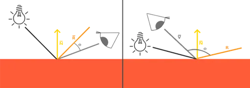

# Personne B — Éclairage et matériaux

## Mission

Implémenter `computeLocalShading`, `isInShadow` et `Renderer::trace` uniquement.
C conserve `Renderer::render`.

Pour chaque lumière, `N` est la normale, `V=normalize(-viewRay.direction)` et
`L=normalize(light.position-point)`. L'ambiant est ajouté une seule fois :
`ambient*albedo`. Hors ombre, ajouter
`light.color*intensity*(diffuse*max(N·L,0)*albedo + specular*spec)`, avec
`R=reflect(-L,N)` et `spec=max(R·V,0)^shininess` seulement si le diffus est
positif. Ne jamais clamper avant l'export.

L'ombre utilise un rayon de direction `L`, `tMin=RAY_T_MIN` et
`tMax=distance(point,light)-RAY_T_MIN`; cela évite l'acné et les objets derrière
la lampe. Une réflexion utilise aussi `RAY_T_MIN`. `trace` retourne `skyColor`
à profondeur maximale ou sans intersection, sinon combine local et réflexion :
`(1-k)*local+k*reflected`.

## Plan heure par heure

- [ ] 1,5 h : comprendre N, L, V et R.
- [ ] 1,5 h : ombres.
- [ ] 2 h : ambiant et diffus.
- [ ] 1 h : spéculaire.
- [ ] 2 h : trace et réflexion.
- [ ] 1 h : régler demo.scene.
- [ ] 1 h : intégration.

## Tests à écrire
Avec un point `(0,0,0)`, normale `(0,1,0)`, lumière blanche en `(0,10,0)`,
albedo rouge et ambient `0.1`, diffuse `0.8`, le résultat diffus est `(0.9,0,0)`.
Une lumière sous la surface ne donne que l'ambiant ; le test spéculaire attendu
est `(1.4,0.5,0.5)` et reste volontairement non clampé. Vérifier les ombres
devant, derrière et sous la lampe, puis `reflectivity=0` et `maxDepth=0`.

## Pièges

Normaliser L et V, utiliser RAY_T_MIN, ignorer le spéculaire si le diffus est
nul, borner la base de pow à zéro, arrêter la récursion et ne pas clamper tôt.

## Contrat

A fournit un `HitRecord` fiable ; B renvoie une `Color` linéaire non clampée.

## Définition de « fini »

Les valeurs Phong, ombres et réflexions sont vérifiées sans clamp prématuré,
et C peut conserver exclusivement `Renderer::render`.

# Théorie

## Vecteurs de PHONG

Le modèle de Phong calcule la couleur d'un point de la surface à partir de quatre vecteurs, tous définis **au point touché** `P`. Ils sont **normalisés** (longueur 1) et tous orientés **en partant de la surface**. Pour deux vecteurs unitaires, le produit scalaire est égal au cosinus de l'angle qui les sépare : 1 s'ils sont alignés, 0 s'ils sont perpendiculaires, négatif s'ils sont opposés. C'est ce qui permet de mesurer l'éclairage avec de simples produits scalaires.

### Les quatre vecteurs

| Vecteur | Rôle | Formule |
|---|---|---|
| **N** | Normale à la surface | Fournie par le `HitRecord` |
| **L** | Direction vers la lumière | `L = normalize(light.position - P)` |
| **V** | Direction vers l'œil | `V = normalize(-viewRay.direction)` |
| **R** | Direction de réflexion de la lumière | `R = reflect(-L, N)` |



**N : la normale.** Vecteur perpendiculaire à la surface en `P`. Elle est orientée contre le rayon incident, donc toujours tournée vers l'observateur. Elle est calculée lors de l'intersection (`HitRecord::setFaceNormal`) et fournie dans le `HitRecord`.

**L : direction vers la lumière.** Vecteur unitaire allant de `P` vers la lampe. La distance `‖light.position - P‖` est conservée pour le calcul des ombres.

**V : direction vers l'œil.** Vecteur unitaire allant de `P` vers la caméra. Le rayon de vue va de la caméra vers le point : on l'inverse pour que `V` parte de la surface.

**R : direction de réflexion.** Direction dans laquelle un miroir parfait renverrait la lumière issue de la lampe, avec `reflect(d, n) = d - 2·(d·n)·n`. On passe `-L` car la fonction attend un vecteur incident (qui arrive sur la surface), alors que la lumière arrive de la lampe vers le point.

### Les trois composantes de l'éclairage

| Composante | Formule | Interprétation |
|---|---|---|
| Ambiante | `ambient · albedo` | Lumière indirecte, indépendante des vecteurs |
| Diffuse | `diffuse · max(N·L, 0) · albedo` | La surface est-elle face à la lampe ? |
| Spéculaire | `specular · max(R·V, 0)^shininess` | L'œil est-il dans l'axe du reflet ? |

- **Ambiante** : ajoutée **une seule fois** par point, et non par lumière.
- **Diffuse** : maximale quand la lampe est face à la surface, nulle quand elle est rasante ou derrière.
- **Spéculaire** : plus `shininess` est grand, plus le reflet est petit et net. Elle n'est calculée que si le diffus est **strictement positif**, pour éviter un reflet fantôme provenant d'une lampe située derrière la surface.

Pour chaque lumière non masquée par une ombre, la contribution est :

```text
light.color · intensity · (diffuse · max(N·L, 0) · albedo + specular · spec)
```

Les couleurs restent **linéaires** et ne sont pas bornées avant l'export de l'image.


